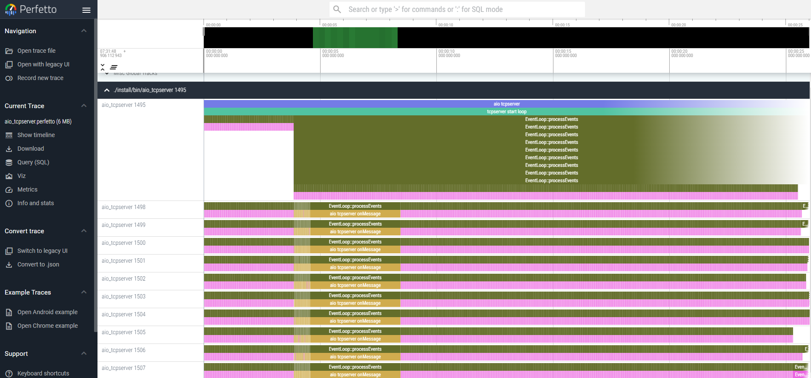

[](https://deepwiki.com/zczjx/posix-bsp-perf)
# posix-bsp-perf

bsp perf test for posix OS(such as Linux/QNX/Rtthread)

## Design doc

You can follow the AI generated wiki to get the Structure of the project and ask AI the question and demo.

[Design doc](https://deepwiki.com/zczjx/posix-bsp-perf)

## Supported platforms

| Platform | Status | Recommended way |
| --- | --- | --- |
| Jetson | Mainly supported | Cross-compile on an x86 host inside the Docker build container |
| RK3588 (rk3588s) | Mainly supported | Cross-compile on an x86 host inside the Docker build container |
| x86 | Not recommended | Most features are missing and there may be compile errors |

## Build in Docker (recommended)

- Dockerfile.base is base image for building
- Dockerfile is the actual building env for posix bsp(use this one)

1. Build the docker image from the project root (see [get_build_env_docker.sh](./get_build_env_docker.sh) for all commands). When completed, you will get a docker image named `bsp-perf-build-env-x86:v0.0.1` from pulled image `zczjx/bsp-perf-build-env-x86-base:latest`.

   ```bash
   docker build --build-arg USER_ID=$(id -u) --build-arg GROUP_ID=$(id -g) --build-arg DIR_SRC_PATH=tools_conf -t bsp-perf-build-env-x86:v0.0.1 -f Dockerfile .
   ```

2. Start the container. You can drop `--gpus all` if you don't have a GPU. Remember to map the posix source directory to the container using the `-v` option.

   ```bash
   docker run --network=host --gpus all --privileged --user $(id -u):$(id -g) -it -e DISPLAY=$DISPLAY -v /tmp/.X11-unix:/tmp/.X11-unix -v /build:/build -v /dev/bus/usb:/dev/bus/usb bsp-perf-build-env-x86:v0.0.1 /bin/bash
   ```

3. Inside the container, initialize the shell environment and load the config of your target platform (`.bashrc.rk3588s` or `.bashrc.jetson`). Run `source` in every new terminal, and do not mix platforms in one terminal:

   ```bash
   cd /opt/tools_conf/
   ls -A | grep '^\.' | xargs -I {} cp -r {} ~/
   source /opt/tools_conf/.bashrc.rk3588s     # or .bashrc.jetson
   ```

4. Configure and build in `build/` under the project root. The spdlog and CLI11 libraries are already installed in the container. Example for **RK3588** (use `-DCMAKE_BUILD_TYPE=Debug` for gdb debugging, `Release` for `-O2` or higher optimization):

   ```bash
   mkdir -p build && cd build
   cmake .. -DBSP_PKG_CONFIG_PATH=/opt/cross_env/rk3588s/install/lib/pkgconfig:/opt/cross_env/rk3588s/install/share/pkgconfig \
       -DBSP_LIB_PATH=/opt/cross_env/rk3588s/install/lib \
       -DBUILD_PLATFORM_RK35XX=ON \
       -DBUILD_APP_DATA_RECORDER=ON \
       -DCMAKE_BUILD_TYPE=NoOptimize
   make -j8 install
   ```

   The recommended **Jetson** configuration and other options are in [reference_build_cmd.sh](./reference_build_cmd.sh) and [AGENTS.md](./AGENTS.md). Build artifacts are installed to `build/install`.

## Build with an AI agent

[AGENTS.md](./AGENTS.md) ([中文版](./AGENTS.zh-CN.md)) describes the build environment, the per-platform cmake parameters and common mistakes. AI coding agents read it automatically to generate correct build commands, and you can also point your own AI assistant at it.

## Build locally (Not recommended)

You can set up the build environment on your local Ubuntu system and build by yourself. Please reference the commands in [local_env_pkgs_intall.sh](./local_env_pkgs_intall.sh) to install the required packages (or if you don't like to use docker). The paths in the cmake commands above must then be adapted to your machine.

If you run into problems, please [open an issue](https://github.com/zczjx/posix-bsp-perf/issues).

## BSP Trace Event Visualization

upload the *.perfetto profiler file to [perfetto](https://ui.perfetto.dev/) to analyze the perf data at local web browser

- BspTrace visualization demo

  

## Tracing Branch

Tracing branch(``git checkout -b tracing origin/tracing``) is for deep tracing in the src code, will leave so many trace event tags in the code for analysis
User could do ``git pull origin master --rebase`` to sync and merge the latest master ToT to tracing branch
